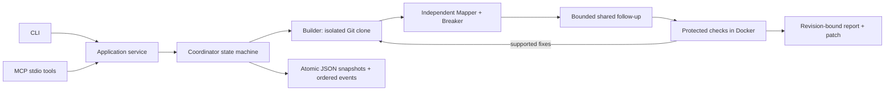

# TaskHeist

**One mission. Three agents. Every move checked.**

TaskHeist is an MIT-licensed local CLI and MCP server. Builder **Ulla** changes an isolated copy of a Git repository. Mapper **Veliya** reconstructs behavior independently; Breaker **Veliya** requests executable regression checks. A coordinator records their structured artifacts and only reports completion when executable evidence supports the fixed acceptance criteria.

This is an MVP, not a correctness guarantee. Mock decisions are scripted and always labeled. The local Heist Room dashboard follows recorded work. No automatic merge, push, deployment, or publishing is included.



## Install

Use a supported Node.js LTS release (Node 22.18+ or Node 24), Git, and Docker with Linux containers. Use a current patched release in production. No global npm installation is needed.

```sh
npm ci
npm run build
docker pull node:22-alpine
```

The Docker image must be preloaded. Runs use `--pull=never` and never download dependencies implicitly. If Docker is absent, the run stops as `needs_attention`; no target code runs on the host.

## Offline demo

```sh
npm run demo
```

The demo creates a clean, deliberately faulty TypeScript fixture under `.taskheist/demo-*`. The first round reproduces duplicate credit. The scripted Builder then installs a correction, and real container tests check duplicate IDs, distinct IDs, and account isolation. The regression test is stored outside the Builder workspace. The demo is offline after dependencies and the image have been installed.

The fixture models synchronous, in-memory behavior only. Restart persistence, distributed processing, transactions, retries after partial failure, and database concurrency are outside its acceptance criteria. See `fixtures/webhook` for the faulty source, corrected source, and regression test. The mock provider is specifically for this fixture, not a general coding model.

Without Docker, the explicit demo completes with **SIMULATED DEMO EVIDENCE** after inspecting the known fixture as data. It does not execute repository code on the host. Real task runs still stop at `needs_attention` when Docker is unavailable. A simulated demo does not demonstrate container execution.

## CLI

Create a task file (absolute repository path recommended):

```json
{
  "repo": "/absolute/path/to/clean-git-repo",
  "request": "Make webhook processing idempotent so duplicate events do not credit an account twice.",
  "provider": "openai",
  "rounds": 3,
  "timeMs": 600000,
  "tokenLimit": 50000,
  "network": false,
  "criteria": [],
  "checks": []
}
```

Empty criteria are derived before building. You may supply fixed criteria as `{ "id": "AC1", "description": "..." }`. Required checks have `id`, `criterionIds`, an argv `command`, and `test` (JavaScript source or `null`). Supplied and reviewer-authored checks cannot be replaced once registered. For example, `command: ["node", "--experimental-strip-types", "/verifier/test.mjs"]` executes the supplied test. Source files are at `/workspace`.

```sh
node dist/cli.js start task.json
node dist/cli.js status RUN_ID
node dist/cli.js findings RUN_ID
node dist/cli.js cancel RUN_ID
node dist/cli.js report RUN_ID --markdown --out report.md
node dist/cli.js report RUN_ID --out report.json
```

`start` prints a run ID promptly and stays attached while the service runs asynchronously. Use another terminal for status or cancellation. The MCP entry returns immediately without waiting for completion. Exit codes: 0 completed/read operation, 1 invalid invocation or unexpected failure, 2 unresolved task. Runs survive on disk, but a stopped process is not resumed automatically.

`TASKHEIST_HOME` selects the artifact directory (default `.taskheist` in the working directory). All clients inspecting a run must use the same directory. `TASKHEIST_REPO_ROOT` optionally restricts tasks to a real filesystem root. Target repositories must be clean, committed, local Git roots; uncommitted work is never silently omitted. The original repository is not edited.

## Heist Room dashboard

```sh
npm run dashboard
# Or after npm run build:
node dist/cli.js dashboard
# Optional port:
node dist/cli.js dashboard 4318
```

Open **http://127.0.0.1:4317**. Start tasks from another terminal or your MCP client using the same `TASKHEIST_HOME`. The room discovers newly saved runs, shows live agent activity and structured handoffs, and links findings, diffs, and execution records to their exact revisions. Cancel requests use the existing application service; they also reach runs owned by another process through the persisted cancellation marker.

The mission archive includes earlier runs. **Replay** steps through recorded events, while the slider lets you inspect an exact point. Finding status and evidence availability reflect that point, without borrowing later results. **Latest** returns to the live record. The timeline follows new messages only when you are already near its bottom. The report button downloads the **full public run report**, even when the timeline is paused in replay. Old runs without detailed agent events remain readable; historical metrics and links are not invented.

The server reads atomic persisted snapshots every 200ms and sends ordered SSE events with their persisted sequence as `id`. Reconnects honor `Last-Event-ID` (or the initial `after` cursor), replay missing events, and send a current public snapshot. The browser deduplicates by sequence. No new agent loop or model calls are introduced. Closing the dashboard does not cancel independently running CLI/MCP tasks.

It binds exclusively to IPv4 loopback. Host/origin validation, cancellation tokens, a restrictive Content Security Policy, and text-only rendering protect the local interface. The public projection omits raw model outputs, prompts, repository read contents, workspace paths, and environment data; it redacts known credential values and common credential assignments. Agent messages are coordinator-authored descriptions of observed actions, never private reasoning or invented dialogue. Artifact bodies remain untrusted repository/test data; redaction is not a comprehensive secret scanner. Do not commit secrets to target repositories.

Browser verification:

```sh
npx playwright install chromium
npm run test:e2e
```

The Chromium end-to-end test exercises the real coordinator/service, persistence, HTTP server, SSE disconnection/reconnect, historical replay, evidence links, cancellation, report download, untrusted HTML rendering, credential redaction, and mobile layout. It uses an explicitly labeled simulated executor to test dashboard behavior without running target code on the host. It does not replace the Docker integration test.

## Provider configuration

The real adapter uses the official OpenAI SDK, the Responses API, and Zod structured outputs. Set `OPENAI_API_KEY` in the process environment. `.env.example` documents variables; files are not automatically loaded.

```sh
# POSIX shell; in PowerShell use $env:NAME = "value"
export OPENAI_API_KEY="your-key"
export TASKHEIST_BUILDER_MODEL="gpt-4.1"
export TASKHEIST_MAPPER_MODEL="gpt-4.1"
export TASKHEIST_BREAKER_MODEL="gpt-4.1"
npm run demo -- --real
```

Models are configurable independently; access depends on the provider account. The planning call uses the Builder model. Each phase allows four structured turns and twelve actions per turn. Supported actions are bounded reads, full-file implementation replacements, and test requests. The SDK retries transient errors up to twice, with a 60-second request timeout and run-level cancellation. Malformed or refused output fails closed; it never becomes a patch.

Token usage from successful responses is recorded; conservative reservations prevent starting calls too close to the configured limit. Reservations for failed calls remain counted, so reported usage may be an upper bound. Provider retry billing can be unknown. USD cost is `unknown` unless both `TASKHEIST_INPUT_PRICE` and `TASKHEIST_OUTPUT_PRICE` are configured in dollars per million tokens. That optional tariff applies to all roles; configure matching tariffs/models if using it.

## MCP configuration

Start the built server directly so npm banners cannot enter protocol stdout:

```sh
node dist/cli.js mcp
```

For clients using the common `mcpServers` JSON configuration shape:

```json
{
  "mcpServers": {
    "taskheist": {
      "command": "node",
      "args": ["D:/Software/TaskHeist/dist/cli.js", "mcp"],
      "env": {
        "TASKHEIST_HOME": "D:/Software/TaskHeist/.taskheist",
        "TASKHEIST_REPO_ROOT": "D:/Software"
      }
    }
  }
}
```

Replace paths for your machine and supply credentials through the client's secure environment mechanism. Client configuration layouts vary. The included official SDK test client verifies the stdio launch, discovery, argument rejection, and all five tools: `start_task`, `get_task_status`, `list_findings`, `get_task_report`, `cancel_task`.

MCP exposes this workflow to compatible clients. Connecting it **does not automatically intercept every action performed by the host AI tool**. The client must invoke `start_task`. The server is local stdio only, without a network listener. Logs go to stderr.

## Evidence and completion

Normal transitions are `queued → planning → building → reviewing → verifying → completed`, with `verifying → building` for corrections. Terminal alternatives are `needs_attention`, `budget_exceeded`, `failed`, and `cancelled`. Default limit: three build/review rounds, ten minutes, 50,000 tokens.

Initial reviews do not receive the Builder's explanation or each other's findings. A single follow-up shares structured findings. Exact duplicate findings are combined. Model-provided finding status is never trusted: execution establishes confirmation or resolution; unsupported blocking hypotheses remain blocking.

Completion requires every registered check to have passed for the final SHA-256 content revision, evidence mapped to every criterion, and no unresolved blocking finding. Any failed or contradictory execution on that same revision prevents completion. Changing a file invalidates old evidence. Reviewer consensus alone cannot complete a run. Passing tests support only the behavior they actually test; model-written tests can be incomplete or wrong.

Artifacts include validated task/criteria, assumptions, raw model claims, observed reads, command argv, exit code, bounded output, duration, timeout status, tested revision, patches, findings, and ordered events. `patch.diff` is reviewable, never automatically applied to the source. Inspect it before manually applying. JSON snapshots use fsync plus atomic replacement, with Windows sharing-violation retries. Recovery marks dead-owner unfinished runs `needs_attention`; PID reuse and machine power-loss guarantees are MVP limitations. Criteria amendments require a new run in this MVP.

## Execution boundaries

- A separate Git clone is isolation, **not a security sandbox**. Generated code only runs in Docker.
- Containers have read-only repository/verifier mounts, read-only root filesystem, non-root UID, dropped capabilities, no-new-privileges, 256MB memory, one CPU, 64 PIDs, a bounded temporary filesystem, and a 60-second command timeout. No host credentials or Docker socket are mounted. Network defaults to `none`; `network: true` is explicit opt-in.
- Builder cannot write common test/spec paths, acceptance files, `AGENTS.md`, Git internals, or external verifier artifacts. Symlinks and path traversal are rejected. Only coordinator-controlled writes reach the workspace.
- The fixed Node image and read-only workspace do not support arbitrary build ecosystems or package installation. Use self-contained tests; dependency-heavy projects can remain unresolved. Container runtime vulnerabilities and hostile code still require appropriate host isolation.
- Repository text and tool output are untrusted data. Only validated structured actions execute. Known credential environment values are redacted from persisted reports/logs; credential-like file reads are denied. This is not a comprehensive secret scanner: do not point the tool at repositories containing committed secrets.
- Repo/file/action limits bound the MVP. Cancellation stops active provider calls and removes active containers; Git operations have their own bounded timeout. Artifacts are retained until manually removed. No automatic cleanup or resume is implemented.

## Development and verification

```sh
npm run format:check
npm run typecheck
npm test
npm run build
npm run demo
```

Tests cover transitions, round/token/time limits, failure and stale-evidence gates, malformed outputs, cancellation, protected paths, persistence/recovery, and real MCP stdio behavior. Coordinator unit tests use a clearly labeled simulated executor and never claim to execute target code. The separate Docker integration test executes the complete offline demo or explicitly skips when Docker is unavailable.

Official references checked during implementation:

- [MCP TypeScript SDK server and validation](https://ts.sdk.modelcontextprotocol.io/v2/get-started/first-server.html)
- [MCP stdio transport](https://ts.sdk.modelcontextprotocol.io/v2/serving/stdio.html)
- [OpenAI structured outputs](https://developers.openai.com/api/docs/guides/structured-outputs?api-mode=responses)
- [Node.js supported releases](https://nodejs.org/en/about/previous-releases)
